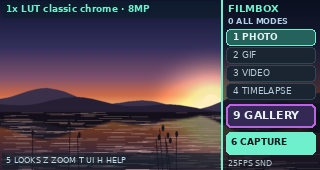
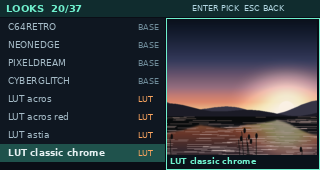
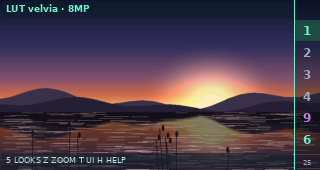
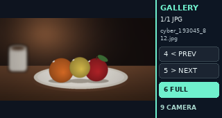

# FilmBox

**Film-simulation camera for the M5Stack Cardputer Zero.**
8 MP stills, 18 film looks, 4-step zoom, GIF/MP4/timelapse, and a QR-code Wi-Fi
gallery — all on a 320×170 framebuffer driven by the IMX219 sensor.

[中文说明](README.zh-CN.md)



| Looks picker | Pure-framing mode | Gallery |
|---|---|---|
|  |  |  |

## Features

- **Full-sensor 8 MP photos** — the viewfinder runs on `1640×1232`, a still
  switches to `3280×2464` for a moment and returns immediately (0.8–1.0 s).
- **18 film looks** — Fujifilm-style positives/negatives/ACROS, Kodak Portra,
  Ektar, Ektachrome, Kodachrome, Ilford HP5, plus three negative looks and a
  Hasselblad-inspired natural look built for this project. `.cube` files are
  plain 3D LUTs (sRGB in / sRGB out), so you can drop in your own.
- **4-step zoom** — 1× / 1.5× / 2× / 3× via `ScalerCrop`; photos are taken at
  full width and cropped in software, so quality never depends on the zoom.
- **Full-bleed viewfinder** with a translucent side panel, or a slim
  *pure framing* mode with just the numbers.
- **Photo, GIF, video, timelapse, stop-motion, boomerang** modes.
- **QR Wi-Fi gallery** — press `W`, scan with a phone on the same network, and
  save the shots straight from the browser. Token-protected, read-only.
- **Silent by default**, with an optional synthesised shutter click.

## Hardware

- M5Stack Cardputer Zero (Raspberry Pi CM0, 320×170 RGB565 framebuffer,
  TCA8418 keyboard, IMX219 8 MP camera)
- Raspberry Pi OS with `picamera2`, `python3-pil`, `python3-numpy`,
  `python3-evdev`, `ffmpeg`

## Install

### Package

```bash
scp filmbox_0.6.0_all.deb pi@<device>:/tmp/
ssh pi@<device> "sudo dpkg -i /tmp/filmbox_0.6.0_all.deb"
```

The app appears in the APPLaunch launcher as **FilmBox**.

### From source

```bash
scp -r . pi@<device>:~/filmbox-src/
ssh pi@<device> "cd ~/filmbox-src && sudo ./install.sh"
# or just run it without installing:
ssh pi@<device> "python3 ~/filmbox-src/filmbox.py ui"
```

LUTs are read from `~/.config/filmbox/luts/`. Copy the ones you want from
`luts/` (all 18 are MIT licensed and redistributable).

### Upgrading from CyberCam

Settings, LUTs and photos are copied once from the old
`~/.config/cybercam` and `~/Pictures/CyberCam` layout on first start.

## Keys

| Key | Action | Key | Action |
|---|---|---|---|
| `1`–`4` | Photo / GIF / Video / Timelapse | `5` | Looks picker |
| `6` | Capture / start / stop | `7` | Size, interval, export |
| `8` | Sound on/off | `9` | Gallery |
| `0` | All modes menu | `L` | Jump to the LUT section |
| `Z` | Zoom 1× / 1.5× / 2× / 3× | `T` | Pure framing mode |
| `W` | Wi-Fi share (QR code) | `H` | Help / key map |
| `DEL` | Delete in gallery (press twice) | `ESC` | Back / quit |

## CLI

```bash
filmbox photo  -o shot.jpg --lut fuji_classic_chrome
filmbox video  --seconds 10 --video-quality 720p
filmbox gif    --seconds 3
filmbox timelapse --frames 60 --interval 2
filmbox web    --port 8765          # gallery server only
filmbox diagnose                    # camera / framebuffer report
filmbox config --set preview_fps=15
```

## How it works

- **One Picamera2 session** handles preview, stills and video. Stills switch to
  a `3280×2464` configuration for the capture and switch back, instead of
  restarting a subprocess (the earlier design froze the UI for seconds).
- libcamera's `RGB888` buffer is **BGR in memory**; frames are flipped once
  before hitting PIL — otherwise oranges turn blue.
- Lights are applied on save only: 3D LUT → halation → grain → JPEG q93. An
  8 MP render takes ~7.6 s; if `MemAvailable` drops below 110 MB it falls back
  to 2 MP. The check runs *before* decoding, because an 8 MP decode alone
  costs ~24 MB.
- Video is MJPEG in an MP4 container (`ffmpeg -c:v copy` on stop) — hardware
  H.264 on this board only manages ~8 fps. The container frame rate is derived
  from *frames ÷ duration*, not from a single frame's metadata.
- Settings are written with a dirty flag, at most once per second, and flushed
  on exit, so holding an arrow key never stalls the SD card.

## Building the package

```bash
cd packaging && python3 make_package.py     # → ../filmbox_0.6.0_all.deb
```

`make_package.py` also synthesises `shutter.wav`, so no audio file is vendored.

## Generating the store screenshots

The images in `screenshots/` are rendered, not photographed:

```bash
python3 tools/gen_scenes.py                 # three procedural scenes
python3 tools/mockshots.py                  # 320×170 UI renders
```

`mockshots.py` imports the app's own drawing functions, so the UI is pixel
identical to the device.

## Layout

```
filmbox.py              the whole application (~3 000 lines, no deps beyond apt)
packaging/make_package.py   .deb builder + shutter sound generator
luts/                   18 MIT .cube looks
tools/                  scene generator, screenshot renderer, LUT composer
screenshots/            320×170 store images
selftest.py             camera-layer self test
```

## Performance

An 8 MP film copy is the expensive part. Measured on the Cardputer Zero
(aarch64, 512 MB, `FILMBOX_ACCEL` selects the engine):

| Engine | 8 MP render | Status |
|---|---|---|
| `cpu` (default) | **5.1–6.5 s** | stable; Pillow `Color3DLUT` + integer grain |
| `multi` | — | forks 4 workers; exhausts 512 MB and triggers the OOM killer, disabled by default |
| `gpu` | 0.77 s for the LUT round-trip in a standalone probe | the vc4 driver segfaults inside `glTexImage2D` once the renderer is driven from the app; experimental |

`filmbox diagnose` prints which engine is active. The GPU and multi-core code
is kept in `filmbox.py` (`tools/gpu_lut.py` holds the working prototype) so it
can be fixed on drivers that behave.

## License

MIT — see [LICENSE](LICENSE) and [NOTICE](NOTICE). FilmBox is a fork of
[CyberCam v0.5.3](https://github.com/cybern0mads/CyberCam) by Cybern0mads.
Product names in LUT files (Kodak, Fujifilm, Ilford, Hasselblad, …) are
trademarks of their owners and only describe the intended look.
