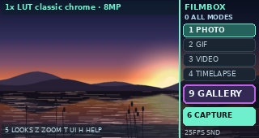
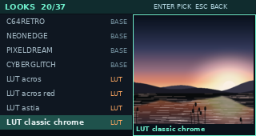
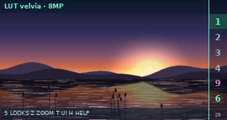
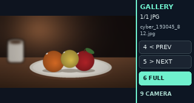

# FilmBox 胶片盒子

**给 M5Stack Cardputer Zero 的胶片模拟相机。**
800 万像素照片、18 支胶片 LUT、四档变焦、GIF / 录像 / 延时，还有一个扫码就能取图的 Wi-Fi 相册 ——
全部跑在 320×170 的屏幕上，由 IMX219 传感器供图。

[English](README.md)



| 胶片选择器 | 纯净取景 | 相册 |
|---|---|---|
|  |  |  |

## 特性

- **全画幅 800 万像素**：取景跑 `1640×1232`，快门瞬间切到 `3280×2464`，
  拍完立刻回取景（0.8–1.0 秒），不像老方案那样要停流几秒。
- **18 支胶片 LUT**：富士系的 Provia / Velvia / Astia / Classic Chrome /
  PRO Neg / ACROS，柯达 Portra、Ektar、Ektachrome、Kodachrome，依尔福 HP5，
  外加三支为本项目自建的负片观感和一支哈苏风格的「自然」。
  都是 sRGB 进 / sRGB 出的普通 `.cube`，你可以直接丢自己的进去。
- **四档变焦**：1× / 1.5× / 2× / 3×，用 `ScalerCrop` 实现；拍照始终拍全幅再软件裁切，
  所以画质不随变焦下降。
- **全屏取景**，右栏半透明叠在画面上；也可以切「纯净模式」，只留极窄的数字条。
- **照片 / GIF / 录像 / 延时 / 定格 / 回旋镖** 六种模式。
- **扫码取图**：按 `W` 起本地相册服务并显示二维码，同一网络下手机扫码即可浏览、保存。
  带 token 校验，只读。
- **默认静音**，可开一个合成的快门声。

## 硬件要求

- M5Stack Cardputer Zero（树莓派 CM0 / 320×170 RGB565 / TCA8418 键盘 / IMX219 800 万像素）
- Raspberry Pi OS，装好 `picamera2`、`python3-pil`、`python3-numpy`、`python3-evdev`、`ffmpeg`

## 安装

### 装包

```bash
scp filmbox_0.6.0_all.deb pi@<设备>:/tmp/
ssh pi@<设备> "sudo dpkg -i /tmp/filmbox_0.6.0_all.deb"
```

启动器里会出现 **FilmBox**。

### 从源码跑

```bash
scp -r . pi@<设备>:~/filmbox-src/
ssh pi@<设备> "cd ~/filmbox-src && sudo ./install.sh"
# 也可以不安装，直接跑：
ssh pi@<设备> "python3 ~/filmbox-src/filmbox.py ui"
```

LUT 放在 `~/.config/filmbox/luts/`，把 `luts/` 里你想要的拷进去即可（18 支都可再分发）。

### 从 CyberCam 升级

首次启动时会把旧的 `~/.config/cybercam` 和 `~/Pictures/CyberCam` 复制过来，设置、LUT、照片都不会丢。

## 按键

| 键 | 作用 | 键 | 作用 |
|---|---|---|---|
| `1`–`4` | 照片 / GIF / 录像 / 延时 | `5` | 胶片选择器 |
| `6` | 拍摄 / 开始停止 | `7` | 尺寸、间隔、导出 |
| `8` | 声音开关 | `9` | 相册 |
| `0` | 全部模式菜单 | `L` | 直接跳到 LUT 区 |
| `Z` | 变焦 1× / 1.5× / 2× / 3× | `T` | 纯净取景模式 |
| `W` | 扫码取图 | `H` | 按键说明 |
| `DEL` | 相册内删除（按两次） | `ESC` | 返回 / 退出 |

## 命令行

```bash
filmbox photo  -o shot.jpg --lut fuji_classic_chrome
filmbox video  --seconds 10 --video-quality 720p
filmbox gif    --seconds 3
filmbox timelapse --frames 60 --interval 2
filmbox web    --port 8765          # 只起相册服务
filmbox diagnose                    # 相机 / 屏幕自检
filmbox config --set preview_fps=15
```

## 实现要点

- **一个 Picamera2 会话**包办预览、拍照、录像。拍照时切配置再切回来，不再重启子进程
  （早先的方案会让界面冻结好几秒）。
- libcamera 的 `RGB888` 缓冲区在内存里其实是 **BGR**，所以在交给 PIL 之前要翻一次，
  否则橙色会变蓝。
- 滤镜只在存图时应用：3D LUT → 光晕 → 颗粒 → JPEG q93。8MP 约 7.6 秒；
  `MemAvailable` 低于 110MB 时退到 2MP —— 这个判断必须在解码**之前**做，
  因为 8MP 一解码就吃掉约 24MB。
- 录像用 MJPEG 装在 MP4 里（停止时 `ffmpeg -c:v copy` 转封装）。这块板的硬件 H.264
  只有 8 fps 左右；容器帧率取「帧数 ÷ 时长」，不能写死。
- 设置写盘带脏标记，每秒最多一次，退出时强制落盘 —— 长按方向键不会卡住 SD 卡。

## 构建 deb

```bash
cd packaging && python3 make_package.py     # → ../filmbox_0.6.0_all.deb
```

`make_package.py` 顺便合成 `shutter.wav`，仓库里不放音频文件。

## 商店截图怎么来的

`screenshots/` 里的六张不是拍的，是渲染的：

```bash
python3 tools/gen_scenes.py                 # 三张程序生成的场景
python3 tools/mockshots.py                  # 320×170 界面渲染
```

`mockshots.py` 直接调用应用自己的绘制函数，所以和真机像素一致 —— 只有取景器里的画面是合成图。

## 目录

```
filmbox.py                 整个应用（约 3000 行，除 apt 包外无依赖）
packaging/make_package.py  deb 打包 + 快门音合成
luts/                      18 支 MIT 授权的 .cube
tools/                     场景生成、截图渲染、LUT 合成
screenshots/               320×170 商店图
selftest.py                相机层自检
```

## 性能

8MP 胶片副本是整个流程里最贵的一步。在 Cardputer Zero 上实测（aarch64 / 512MB，用 `FILMBOX_ACCEL` 选引擎）：

| 引擎 | 8MP 出图 | 状态 |
|---|---|---|
| `cpu`（默认） | **5.1–6.5 秒** | 稳定，Pillow `Color3DLUT` + 整数颗粒 |
| `multi` | 2MP：1.55 秒；8MP：不可行 | fork 2 个进程；8MP 时 fork 副本 + 每个进程一张 Pillow 缓冲就触发 OOM，因此限制在 ≤2.5MP |
| `gpu` | ≤5MP：1.1–1.9 秒 | EGL 无窗口 + GLES2。用 `mallopt(M_MMAP_THRESHOLD, 1MB)` 修掉 vc4 段错误。8MP 时整图 + 输出缓冲在 352MB 机器上余量不足、驱动会崩，所以 8MP 仍走 CPU。 |

`filmbox diagnose` 会打印当前生效的引擎。GPU 与多核代码保留在 `filmbox.py` 里
（可运行的原型在 `tools/gpu_lut.py`），以便在正常的驱动上再修。


### 流式实验（默认关闭）

`FILMBOX_STREAM=1` 会用 ffmpeg 把 JPEG 解成 raw 文件，再按 `mmap` 分带渲染。
实测**更差**：20.9 秒 / 峰值 141MB，整图路径是 12.5 秒 / 129MB。
现有管线本来就是 288 行条带处理，峰值已经没有余量可省，而 SD 卡来回读写比省下的更贵。

## 许可

MIT，见 [LICENSE](LICENSE) 与 [NOTICE](NOTICE)。FilmBox 基于
[CyberCam v0.5.3](https://github.com/cybern0mads/CyberCam)（作者 Cybern0mads）改造。
LUT 文件名里的 Kodak、Fujifilm、Ilford、Hasselblad 等是各自公司的商标，仅用于描述风格取向。
